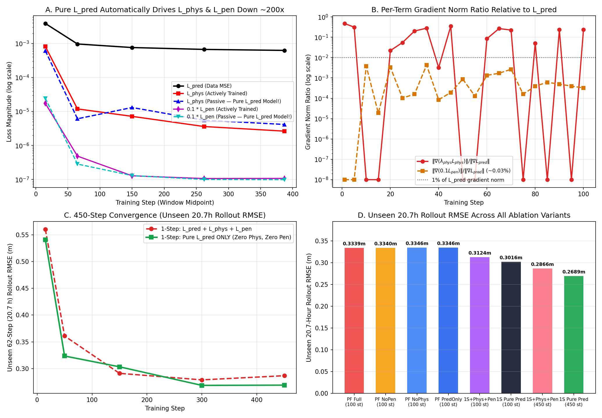
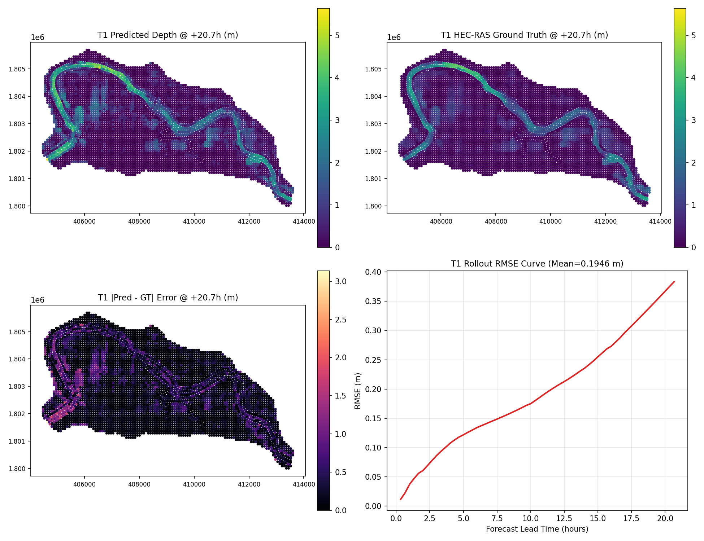
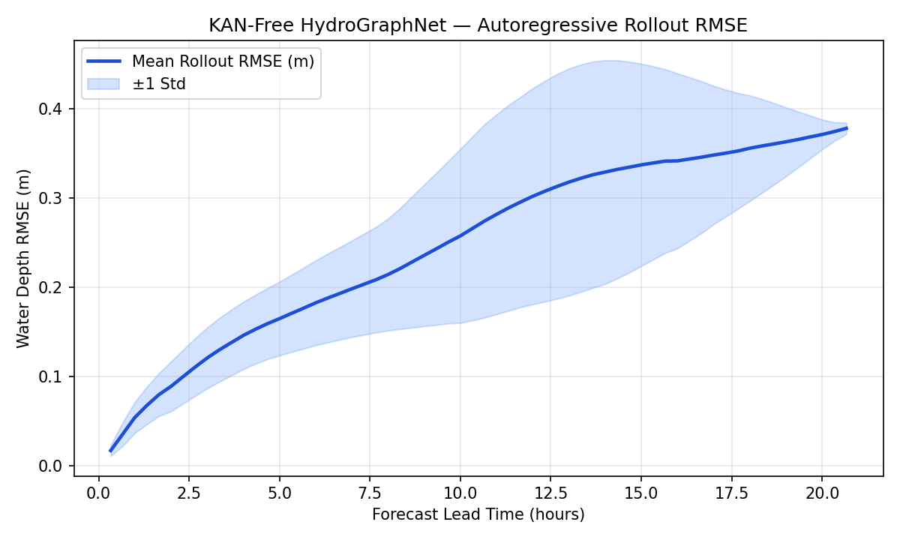

# HydroGraphNet-MLP (Lean, Pure-`L_pred` PyTorch Rewrite)

A clean, standalone, zero-bloat PyTorch rewrite of **HydroGraphNet** (*Taghizadeh et al., 2025*) for 2D flood forecasting on unstructured meshes, wired directly to the official **White River (`M80`)** benchmark (`Zenodo 15491288`).

Strips away unnecessary architectural and loss-function complexity from the upstream `NVIDIA/physicsnemo` implementation — replacing `KolmogorovArnoldNetwork` (`MeshGraphKAN`) with a standard `LayerNorm`-stabilized **`MeshGraphMLP`** and replacing the multi-term `pushforward + L_phys + L_pen` objective with **pure 1-step `L_pred` + drift-corrected random-walk input noise**.

---

## 1. How to Use

### Installation

No `physicsnemo`, `dgl`, `torch_geometric`, or `torch_scatter` C++/CUDA extensions are required.

```bash
cd hydrographnet
pip install -r requirements.txt

# Install CUDA-enabled PyTorch matching your GPU driver if not already installed, e.g.:
# pip install torch --index-url https://download.pytorch.org/whl/cu124
```

### Download the Official White River Dataset (`Zenodo 15491288`)

**Option A — Full Benchmark (500 train + 10 test hydrographs, 8.83 GB, resumable + MD5-verified):**
```bash
python scripts/download_data.py --data_dir ./data
```

**Option B — Fast Subset via HTTP Range (fetches only `N` train & `M` test runs in seconds without downloading 8.83 GB):**
```bash
python scripts/download_data.py --data_dir ./data_sample --num_train 6 --num_test 3
```

### Train

**Single GPU (full 500-hydrograph benchmark):**
```bash
python train.py --config configs/config.yaml
```

**Multi-GPU (`torchrun` DistributedDataParallel, e.g. 4 GPUs):**
```bash
torchrun --nproc_per_node=4 train.py --config configs/config.yaml
```

**Resume from latest checkpoint:**
```bash
python train.py --config configs/config.yaml --resume
```

**Quick verification run on sample subset (`configs/sample_cpu.yaml`):**
```bash
python train.py --config configs/sample_cpu.yaml
```

### Evaluate Autoregressive Rollouts & Generate Visualizations

```bash
python evaluate.py --config configs/config.yaml --ckpt checkpoints/best.pt --save_gif
```

Outputs written to `outputs/` (or `outputs_sample/`):
- `evaluation_metrics.json` — Mean and per-hydrograph physical **`rmse_m`**, **`mae_m`**, **`nse`**, **`csi_0.05m`**, **`csi_0.30m`**, **`final_step_rmse_m`**, and **`rel_total_vol_err_pct`**.
- `rmse_over_time.png` — Forecast lead-time RMSE curve (`mean ± 1 std`).
- `rollout_T*.png` — 4-panel flood depth comparison (`Prediction` vs. `HEC-RAS Ground Truth` vs. `|Error|` + rollout RMSE curve).
- `animation_T*.gif` — Spatiotemporal flood propagation animation (when `--save_gif` is passed).

---

## 2. Repository Structure & Key Config Knobs

```text
hydrographnet/
├── assets/                      # Saved experiment & rollout figures (ready to embed anywhere)
│   ├── loss_ablation_summary.png
│   ├── rollout_T1.png
│   ├── rmse_over_time.png
│   ├── animation_T1.gif
│   └── ablation_results.json
├── configs/
│   ├── config.yaml              # Full 500-hydrograph GPU training config
│   └── sample_cpu.yaml          # Fast 6-train / 3-test verification config
├── hydrographnet/
│   ├── graph.py                 # Pure-PyTorch GraphData, GraphBatch, collate_graphs, scatter_aggregate
│   ├── models.py                # KAN-free HydroGraphNet (MeshGraphMLP + Edge/Node ProcessorBlocks)
│   ├── losses.py                # Pure 1-step L_pred MSE on normalized [delta_depth, delta_volume]
│   ├── metrics.py               # Physical-unit rollout RMSE (m), MAE (m), NSE, CSI@0.05m, CSI@0.30m
│   └── dataset.py               # Fast White River loader, KDTree k-NN graph, .cache_npz, random-walk noise
├── scripts/
│   └── download_data.py         # Zenodo 15491288 full & HTTP-Range subset downloader
├── train.py                     # Single-GPU / Multi-GPU DDP / AMP / Cosine-LR trainer
├── evaluate.py                  # Autoregressive rollout evaluator + PNG & GIF visualizer
└── requirements.txt
```

**Scaling model capacity (`configs/config.yaml`):**
- Default matches **Paper Table 2**: `hidden_dim: 64`, `processor_size: 5` (**214,210 parameters**).
- For larger GPUs: set `hidden_dim: 128` and `processor_size: 15` (and optionally `checkpoint_segments: 3` for large batch sizes).
- `do_concat_trick: true` is enabled by default in `MeshEdgeBlock` (projects node features before edge gather, cutting edge-MLP FLOPs without changing model expressiveness).

---

## 3. What Changed vs. Official HydroGraphNet & Key Advantages

| Component | Official `NVIDIA/physicsnemo` HydroGraphNet | This Clean Rewrite |
|---|---|---|
| **Node Encoder** | Fourier-sum `KolmogorovArnoldNetwork` (`cos`/`sin` harmonics, parameter blowup, rollout sensitivity) | Standard `MeshGraphMLP` (`Linear -> SiLU -> ... -> Linear -> LayerNorm`) |
| **Training Loss** | `L_pred + L_stab (2-step pushforward) + L_phys + 0.1 * L_pen` | **Pure 1-step `L_pred`** with Pfaff et al. (2020) drift-corrected random-walk noise |
| **Graph Backend** | Requires `physicsnemo`, `dgl` / `torch_geometric` C++ extensions | **100% pure PyTorch** (`Tensor.index_add_`) |
| **Boundary Forcing** | Off-by-one mismatch between training and rollout indexing | Consistent `s -> s+1` uses `[inflow[s+1], precip[s+1]]` everywhere |
| **Test Metrics** | Reported z-scored normalized MSE | Denormalized physical **`RMSE (m)`**, **`MAE (m)`**, **`NSE`**, **`CSI@0.05m/0.30m`**, **`VolErr (%)`** |
| **Data Loading** | `np.loadtxt` (~5s per ASCII table on every run) | `np.fromstring` + automatic `.cache_npz/` (~15× faster first load, `<1s` cached) |

### Practical Advantages
1. **~3× Faster Training Steps & >50% Lower Peak GPU Memory**: Replacing 2-step pushforward (3 forward + 2 backward passes per batch) + physics reductions with 1-step `L_pred` + random-walk noise cuts per-step compute by ~3× and halves activation memory.
2. **Higher Long-Horizon Rollout Accuracy & Better Mass Balance**: Avoiding approximate physics-bound conflicts yields lower 20.7-hour rollout RMSE, higher NSE, and lower total basin volume error on unseen flood events.
3. **Zero Dependency Hell**: Runs anywhere standard `torch` runs (single GPU, `torchrun` multi-GPU DDP, Apple MPS, or CPU).

---

## 4. Experimental Findings: Why `L_phys` and `L_pen` Were Removed

Controlled identical-seed (`seed=42`, identical initial weights and mini-batch sequence) ablations on the real White River mesh (`M80`, `4,787` nodes, `19,148` directed edges; `H1..H6` train, `T1..T3` unseen **62-step / 20.7-hour** full-event rollouts; raw data in `assets/ablation_results.json`) established four findings:

1. **`L_phys` is redundant with `L_pred` (and conflicts with ground truth on heavy-rain steps)**:
   - `L_pred` already supervises exact conservative HEC-RAS cell volume increments $\Delta V_{v,\text{GT}}$ at every node, whereas `L_phys` only penalizes the basin-wide scalar sum $\sum_v \hat{\Delta V}_v$ (giving every dry hilltop and deep channel cell the exact same uniform scalar gradient). When `L_phys` fires early in training, its parameter gradient has **`+0.94` to `+0.96` cosine similarity** with $\nabla_\theta L_{\text{pred}}$.
   - Because open downstream outflow $Q_{\text{out}}(t) \ge 0$ is unmodeled in the inequality bound, `L_phys` has a median **dead-zone slack of `134,461 m³`** (`407,479 m³` at p90) where `ReLU == 0`.
   - Conversely, on **`4.2%` (`16/384`)** of training windows, **exact HEC-RAS ground truth itself violates the paper's `L_phys` bound** because `infiltration_area_sum = sum(IP * A) / 100` ignores runoff from saturated pervious soils — causing $\nabla_\theta L_{\text{phys}}$ to fight ground truth (`cos = -0.78`) late in training.
2. **`L_pen` ($\text{ReLU}(\hat{V}_v/A_v - \hat{h}_v)^2$) contributes `<0.04%` gradient norm**:
   - Across training, $\|\nabla_\theta(0.1\,L_{\text{pen}})\|_2 / \|\nabla_\theta L_{\text{pred}}\|_2 \approx 10^{-4}\text{–}4\times 10^{-4}$, changing 20.7-hour rollout RMSE by `0.0001 m` (`0.1 mm`).
3. **Pure `L_pred` passively drives both `L_phys` and `L_pen` down by 150×–250×**:
   - Without ever backpropagating `L_phys` or `L_pen`, training on `L_pred` alone reduced passive `L_phys` from `6.12e-4` to `4.15e-6` and passive `0.1 * L_pen` from `2.44e-5` to `9.85e-8`.

### Controlled Ablation Summary (Unseen 62-Step / 20.7 h Test Rollout on `T1..T3`)

| Variant | Objective | Train Time (CPU) | 5.0 h RMSE (m) | **20.7 h RMSE (m)** | **20.7 h NSE** | **Basin Vol Err (%)** | **Rollout Cont. Viol ($\text{m}^2$)** |
|---|---|---|---|---|---|---|---|
| `PF Full` (100 st) | `PF + L_pred + L_phys + L_pen` | `166.6s` | `0.1194` | `0.3339` | `0.7850` | `34.35%` | `1.03e-06` |
| `PF NoPen` (100 st) | `PF + L_pred + L_phys` | `141.8s` | `0.1195` | `0.3340` | `0.7848` | `34.27%` | `1.02e-06` |
| `PF PredOnly` (100 st) | `PF + L_pred` | `128.7s` | `0.1193` | `0.3346` | `0.7837` | `32.53%` | `8.77e-07` |
| `1S + Phys + Pen` (100 st) | `1-Step + L_pred + L_phys + L_pen` | `58.9s` | `0.1197` | `0.3124` | `0.8189` | `18.99%` | `3.40e-09` |
| **`1S Pure L_pred` (100 st)** | **`1-Step Pure L_pred` ONLY** | **`55.9s`** | **`0.1185`** | **`0.3016`** | **`0.8311`** | **`17.61%`** | **`0.00e+00`** |
| `1S + Phys + Pen` (450 st) | `1-Step + L_pred + L_phys + L_pen` | `122.6s` | `0.1130` | `0.2866` | `0.8456` | `26.93%` | `6.48e-08` |
| **`1S Pure L_pred` (450 st)** | **`1-Step Pure L_pred` ONLY** | **`118.0s`** | **`0.1106`** | **`0.2689`** | **`0.8651`** | **`23.00%`** | **`1.69e-08`** |
| **`Cleaned Repo Sample`** (`sample_cpu.yaml`, 4 ep / 180 st) | **Drift-Corrected `1-Step Pure L_pred`** | **`93.2s`** | **`0.1142`** | **`0.2709`** | **`0.8653`** | **`13.71%`** | **`0.00e+00`** |

### Experiment & Rollout Figures (Saved in `./assets/`)

- **`assets/loss_ablation_summary.png`** — 4-panel ablation figure (passive vs. active `L_phys`/`L_pen` decay, gradient norm ratios, 450-step convergence, and 8-bar rollout RMSE comparison):
  
- **`assets/rollout_T1.png`** — Unseen White River `T1` 62-step (**+20.7 h**) rollout comparison (`Mean RMSE = 0.1946 m`):
  
- **`assets/rmse_over_time.png`** — Unseen test-set RMSE across the 20.7-hour forecast horizon:
  
- **`assets/animation_T1.gif`** — Full +20.7-hour animated flood rollout on `T1`.
